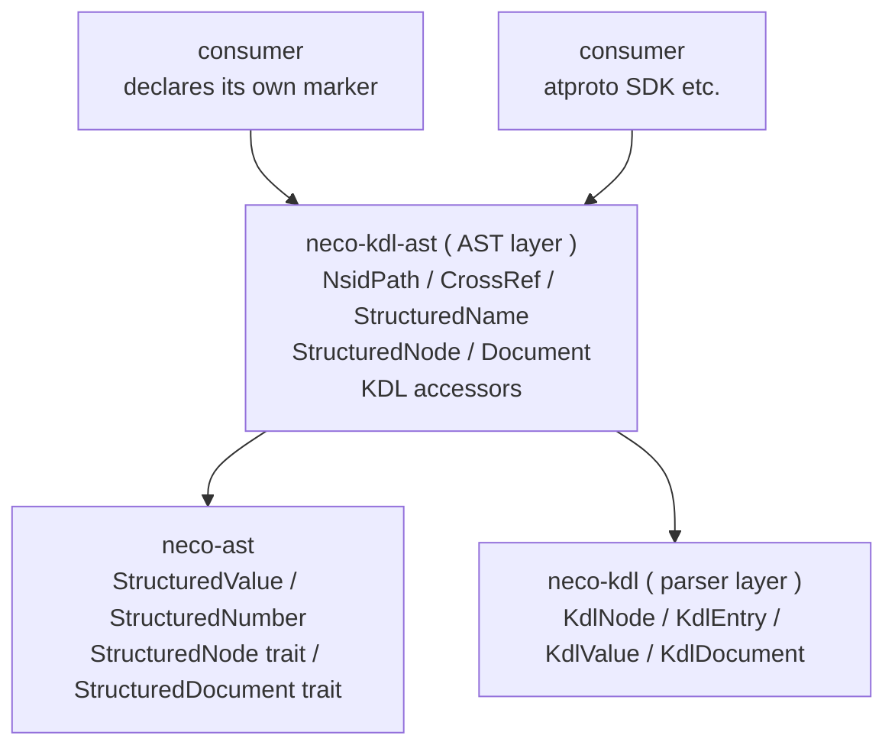

# neco-kdl-ast architecture overview

[日本語](overview.md)

## Position

The parser layer is scoped to turning KDL syntax into the logical structure, a tree of nodes. Notational differences such as the presence of quotes are normalized in the parser layer and treated as equivalent internally.

`neco-kdl-ast` ( the AST layer ) layers namespace, cross-reference, structured naming, and procedural
nesting abstractions on top of the parser's output. Multiple consumers share the same operations, and the shared trait is implemented here as well.

## Responsibilities of the parser and AST layers ( a two-layer framing )

The AST layer is positioned as a two-layer structure: "parser + a parameterizable normalizer":

| Layer | Responsibility |
|---|---|
| `neco-kdl` ( parser ) | KDL syntax to logical structure. Notational differences ( quoting, escaping, whitespace ) are normalized, and every native KDL element is preserved |
| `neco-kdl-ast` ( AST / parameterizable normalizer ) | Builds on the logical structure and a consumer-declared convention to provide namespace paths, cross-references, structured naming, procedural nesting, and the isomorphic transform across five axes |

Semantic keywords such as a kind name or type name belong to the consumer's domain; the AST layer attaches no special meaning to them as reserved words. When a consumer declares, through a convention, that a given prefix or kind name is a marker, the AST layer absorbs that semantic equivalence as a structural round-trip transform.

When a consumer wants to attach semantics to a notational difference, the AST layer takes on that responsibility as a parameterizable normalizer ( see [reference/syntax § Convention and Marker](../reference/syntax-en.md) for details ). An API that preserves the raw form is not provided at this time.

A convention carries a list of marker reserved words together with a per-axis normal-form declaration for axes 1 through 5.
The render step applies the per-axis transforms in the fixed order axis 5 to 4 to 1 to 2 to 3, an order that preserves marker boundaries ( see [reference/syntax § Convention normal-form declaration](../reference/syntax-en.md) for details ).
The default convention has every axis off, so `render_as` is the identity transform by default.
This default keeps existing read accessors' behavior unchanged.

## Consumers and major KDL representations

The AST layer is designed so that each consumer can declare its own vocabulary through a `Convention` and its markers.
The concrete meaning of a kind name or prefix is up to the consumer; the AST layer treats that correspondence as a structural round-trip transform.

The KDL projection of the atproto Lexicon is a public usage example that makes heavy use of axis 4 ( type annotation ) and axis 5 ( kind keyword ). See the worked example in reference/syntax for details.

A consumer can declare its own vocabulary as markers while sharing the same underlying foundation that the AST layer provides.

## Shared structured access

Shared structured access is provided by the neco-ast crate. A structured value tree represents null, bool, number, string, sequence, and mapping, and a structured number holds both the raw string form and its floating-point interpretation at the same time. Two shared traits read format-specific values as a node and as a document, respectively.

`neco-kdl-ast` holds KDL-specific path, reference, layout, and dot-chain accessors. It implements the shared neco-ast traits on its document and node types. Each sibling crate for JSON, TOML, YAML, JSON5, XML, and plist implements the same traits.

## Main types

| Type | Role |
|---|---|
| `NsidPath` | A dot-separated namespace path, a list of segments. Provides a bidirectional mapping to an FS path |
| `CrossRef` | A reference to another entity, covering three forms: path only, path with fragment, and local fragment |
| `StructuredName` | A kind and an identifier pair, a unified representation of form X and form Y |
| `StructuredNode<'a>` | A borrowed view over a parsed node, with kind, identifier, and nesting-depth interpretation |
| `Document` | An owned wrapper over a parsed document, with indexing, resolve, round-trip transforms, and the render step |
| `Convention` | The consumer-declared marker list plus a per-axis normal-form declaration for axes 1-5 |
| `AxisForm` | The enum for axes 1, 2, 4, and 5, covering off, expand, collapse, and their marker-carrying variants |
| `PropertyChildForm` | The enum specific to axis 3, covering off, expand, and collapse ( the fused form only, an axiom of the enum ) |
| `StructuredFacade<'a>` | A five-method trait retained for existing KDL consumers |
| `neco_ast::StructuredNode<'a>` | The shared structured-access trait implemented by `StructuredNode<'a>` |
| `neco_ast::StructuredDocument<'a>` | The shared document trait implemented by `Document` |

See [reference/syntax](../reference/syntax-en.md) for the full syntax and worked examples.
