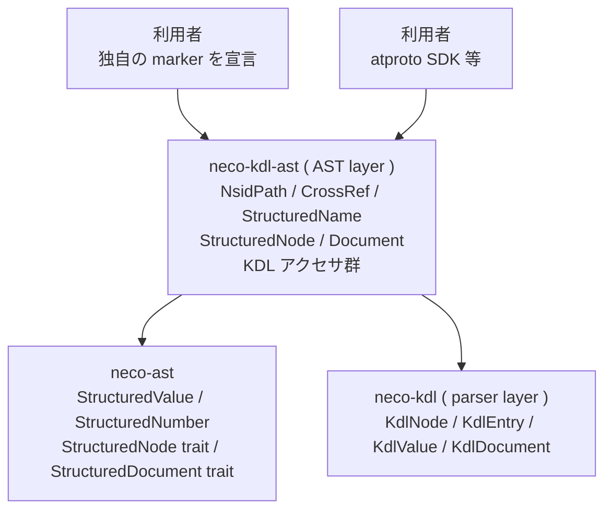

# neco-kdl-ast アーキテクチャ概要

[English](overview-en.md)

## 位置付け

`neco-kdl` ( parser、構文解析器 ) は、KDL の構文を論理構造 ( ノード の木 ) へ変換する役割に専念する。
引用符の有無等の表記の違いは 構文解析層で正規化され、内部では同じ値として扱われる。

`neco-kdl-ast` ( AST layer、構文木の層 ) は構文解析器の出力の上に、名前空間・参照・構造化命名・手続きの
入れ子という抽象を載せる。複数の利用者がこの共通の操作を使い、共有 trait も実装する。
ここでいう名前空間パスは、ファイルシステム上のパス ( FS パス ) と相互変換できる。

## 構文解析層と AST 層の責務 ( 2 層構成 )

AST layer は、「parser」と「設定に応じて動作を変えられる正規化機構 ( normalizer )」から成る 2 層構造として位置付けられる。

| 層 | 責務 |
|---|---|
| `neco-kdl` ( parser ) | KDL 構文を論理構造へ変換する。表記の違い ( 引用・escape・空白 ) は正規化し、全要素を保持する |
| `neco-kdl-ast` ( AST 層、設定に応じて動作を変える正規化機構 ) | 論理構造と利用者が宣言する Convention を受け取り、名前空間パス / 参照 / 構造化命名 / 手続きの入れ子 / 5 軸の同型変換を提供する |

kind 名や型名等、意味を持つ予約語 ( semantic keyword ) は利用者の領域に属し、AST 層はそれ自体に特別な意味を持たせない。
利用者が特定の prefix や kind 名を marker と宣言した場合に限り、AST 層はその等価性を構造的な往復変換として扱う。

表記の違いに独自の意味を持たせたい利用者が現れた場合、その役割は AST 層が設定に応じて動作を変える正規化機構として引き受ける。
詳細は [reference/syntax](../reference/syntax.md) の Convention と Marker の節を参照。
変換前の表記をそのまま保持する API は、現状は提供していない。

`Convention` は marker の一覧に加え、軸 1 から軸 5 までの正規形宣言を持つ。
`render_as` はこの宣言に従い、軸 5・4・1・2・3 の順 ( marker 境界を保護する順序 ) で軸ごとの変換を適用する ( 詳細は [reference/syntax](../reference/syntax.md) を参照 )。
既定の `Convention` は全軸が off であり、この場合 `render_as` は恒等変換になる。

## 利用者と主要な KDL 表現

AST 層は、利用者が宣言する `Convention` と marker によって、呼び出し元ごとに異なる語彙を扱えるように設計されている。
kind 名や prefix の具体的な意味は利用者が決め、AST 層はその対応を構造的な往復変換として扱う。

atproto Lexicon を KDL へ変換した表現は、軸 4 ( 型注釈 ) と軸 5 ( kind キーワード ) を多用する、公開された利用例である。
詳細は reference/syntax の具体例を参照。

利用者は、AST 層が提供する共通の基盤を使いながら、自分の語彙を marker として宣言できる。

## 共有構造参照

共有構造参照は `neco-ast` crate が担う。
`StructuredValue<'a>` は null・bool・number・string・sequence・mapping の値木を表す。
`StructuredNumber<'a>` は、元の文字列表現と `f64` への解釈結果を同時に保持する。
`StructuredNode<'a>` と `StructuredDocument<'a>` は、形式別の値を ノード と文書として読む trait である。

`neco-kdl-ast` は、KDL 固有の NsidPath・CrossRef・layout 判定・dot-chain アクセサ群を保持する。
`Document` と `StructuredNode<'a>` に neco-ast の共有 trait を実装する。
JSON・TOML・YAML・JSON5・XML・plist の各 `*-ast` crate も同じ trait を実装する。

## 主要型

| 型 | 役割 |
|---|---|
| `NsidPath` | dot 区切りの名前空間パス、segment の列。FS パス との双方向変換を提供 |
| `CrossRef` | 別の対象 への参照、`<NsidPath>#<fragment>` の 3 形式を吸収 |
| `StructuredName` | 種類・識別子の対、form X・form Y を統一表現 |
| `StructuredNode<'a>` | `KdlNode` の borrowed view ( 借用ビュー )、種類・識別子・入れ子深さを解釈 |
| `Document` | KdlDocument を所有するラッパー型、索引・resolve・往復変換・render_as を提供 |
| `Convention` | 利用者が宣言する marker の一覧と、軸 1-5 の軸ごとの正規形宣言 |
| `AxisForm` | 軸 1・2・4・5 用 enum ( off・展開・畳込み・marker 付き展開・marker 付き畳込み ) |
| `PropertyChildForm` | 軸 3 専用 enum ( off・展開・畳込みの 3 種類に限られる構造的制約を持つ ) |
| `StructuredFacade<'a>` | 既存 KDL 利用者向けに保持する、5 つの メソッド から成る trait |
| `neco_ast::StructuredNode<'a>` | `StructuredNode<'a>` が実装する共有構造参照 trait |
| `neco_ast::StructuredDocument<'a>` | `Document` が実装する共有文書 trait |

詳細な構文と具体例は [reference/syntax](../reference/syntax.md) を参照。
