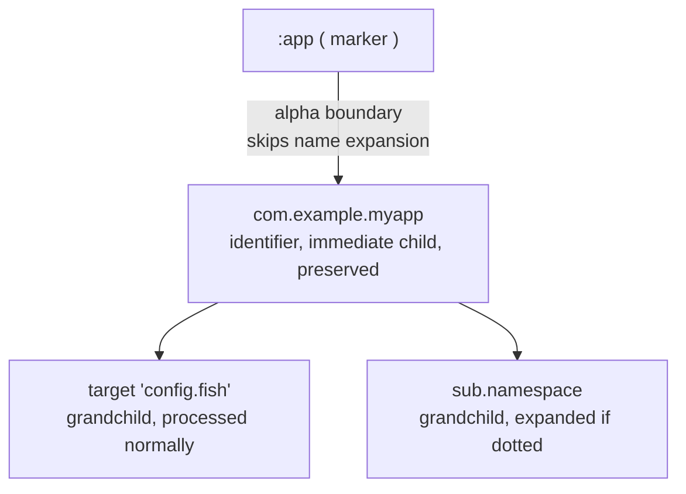

# neco-kdl-ast syntax reference

[日本語](syntax.md)

Shows the notational conventions for using KDL as a container for a structured IR, together with a worked example for each convention.

## Terms

| Term | Definition |
|---|---|
| segment | The unit making up a NsidPath; one non-empty string |
| NsidPath | A finite sequence of 0 or more segments; its string form joins the segments with `.` |
| fragment | A single identifier placed to the right of `#` within a CrossRef |
| form X | The KDL node form `<kind keyword> "<identifier>"` ( e.g. `item "i64.add"` ) |
| form Y | The KDL form that embeds the NsidPath in the node name itself |
| layout mode | The strictness of the correspondence to FS path ( strict, bundle, or cratis dir ) |

## NsidPath

A NsidPath is a finite sequence of 0 or more segments. Each segment is a **non-empty** string that excludes `.` and `#`.

### Notation

```
"a"           ← 1 segment, OK
"a.b.c"       ← 3 segments, OK
""            ← 0 segments, OK ( used for a local-only CrossRef )
"a..b"        ← invalid: consecutive . produces an empty segment
"a.#x.b"      ← invalid: segment "#x" contains #
".a.b"        ← invalid: a leading . produces an empty segment
              ( a leading dot on a node name is interpreted separately as procedural nesting, see below )
```

The check is available as `NsidPath::is_well_formed()`.

### Parse / display round-trip

```rust
NsidPath::parse("")          // → the empty NsidPath ( segments == [] )
NsidPath::parse("a.b.c")     // → segments == ["a", "b", "c"]
NsidPath::parse("a.b.c").display()  // → "a.b.c" ( round-trips )
```

For any well-formed `s`, `NsidPath::parse(s).display() == s`.

### Mapping to FS path

A NsidPath with n segments has the same depth of n when converted to an FS path:

```
NsidPath::parse("app.bsky.actor.getProfile").to_fs_path("json")
// → PathBuf "app/bsky/actor/getProfile.json"   ( 3 directories + 1 leaf = 4 path components )

NsidPath::from_fs_path(
    Path::new("axiom/encoding/base64.kdl"),
    Path::new("axiom/")
)
// → Some(NsidPath ["encoding", "base64"])      ( strips the "kdl" extension, joins dir + file stem )
```

Mapping requires a path under the supplied base and segments that meet the name rules. Mapping failures return `None`.

## CrossRef

Represents a reference to another entity. It contains at most one `#`, and the fragment is a flat identifier.

### Three forms

```
"a.b.c"        ← path only                       → CrossRef { path: [a,b,c], fragment: None }
"a.b.c#frag"   ← path + fragment                  → CrossRef { path: [a,b,c], fragment: Some("frag") }
"#frag"        ← local-only ( current document )  → CrossRef { path: [], fragment: Some("frag") }
```

### Four parse error kinds

| error | example |
|---|---|
| `MultipleHashes` | `"a#b#c"` ( two or more # ) |
| `EmptyFragment` | `"a.b.c#"` ( nothing to the right of # ) |
| `DotInFragment` | `"a.b.c#x.y"` ( a . appears in the fragment ) |
| `EmptySegment` | `"a..b"` ( consecutive . produces an empty segment ) |

### Worked example

```
a path-only reference
  ref "pkg.module.func"
  → CrossRef::parse("pkg.module.func") = path:[pkg,module,func], fragment:None

an atproto Lexicon output reference
  output "app.bsky.actor.defs#profileViewDetailed" encoding="application/json"
  → CrossRef::parse("app.bsky.actor.defs#profileViewDetailed")
    = path:[app,bsky,actor,defs], fragment:Some("profileViewDetailed")

a local reference inside an atproto union
  refs ["#main" "#profileView"]
  → CrossRef::parse("#main") = path:[], fragment:Some("main"), is_local=true
```

## Four forms that express a NsidPath

A NsidPath with n segments has four representations across KDL and FS. Each form shares the same depth n.

### Example: `app.bsky.actor.getProfile` ( 4 segments )

#### Flat KDL form X ( kind keyword plus quoted identifier )

```kdl
item "app.bsky.actor.getProfile" {
    procedure { ... }
}
```

#### Flat KDL form Y ( the NsidPath embedded in the node name )

```kdl
app.bsky.actor.getProfile {
    procedure { ... }
}
```

#### Nested KDL ( 4 nesting levels )

```kdl
app {
    bsky {
        actor {
            getProfile {
                procedure { ... }
            }
        }
    }
}
```

#### FS materialization ( strict 1:1 mode, 3 directories plus 1 leaf file )

```
<base>/app/bsky/actor/getProfile.<ext>
```

### Example: `encoding.base64` ( 2 segments ) as a bundle

`axiom/encoding/base64.kdl` is a path with 2 directories and 1 file, representing `encoding.base64`.
This file holds several entities.
Each entity's identifier carries this path as a prefix.

```kdl
// file: axiom/encoding/base64.kdl
item encoding.base64.encode {
    procedure { ... }
}
item encoding.base64.decode {
    procedure { ... }
}
```

The prefix carried by each entity's identifier is derived from this path.

## Mapping to FS path ( three layout modes )

### Universal mapping

The NsidPath derived from an FS path `<base>/s₁/s₂/.../sₙ.<ext>` under a given base:

```
NsidPath::from_fs_path("axiom/encoding/base64.kdl", base="axiom/")
  → Some(["encoding", "base64"])    // strips the .kdl extension, joins dir + file stem
```

### Strict one-to-one mode ( the atproto style )

The identifier of the single top-level entity in the file equals a specific NsidPath.
This NsidPath is derived from the FS path:

```
file: app/bsky/actor/getProfile.json    ( base = "app/" )
FS-derived NsidPath: [bsky, actor, getProfile]
top entity must have identifier == [bsky, actor, getProfile]

→ verify_layout(Strict1To1, ...) pass
```

A violation example:

```
file: app/bsky/actor/getProfile.json
top entity identifier == "different.path"
→ LayoutViolation { kind: StrictMismatch, ... }
```

### Bundle mode

The identifiers of the several entities in a file each carry the NsidPath derived from the FS path as a strict prefix:

```
file: axiom/encoding/base64.kdl    ( base = "axiom/" )
FS-derived NsidPath: [encoding, base64]
entities in the file:
  item "encoding.base64.encode"     identifier=[encoding,base64,encode]    starts_with [encoding,base64] OK
  item "encoding.base64.decode"     identifier=[encoding,base64,decode]    starts_with [encoding,base64] OK
  item "encoding.base64.decode_url" identifier=[encoding,base64,decode_url] starts_with [encoding,base64] OK

→ verify_layout(Bundle, ...) pass
```

A violation example:

```
file: axiom/encoding/base64.kdl
entities in the file:
  item "i32.add"    ← identifier lacks the prefix
→ LayoutViolation { kind: BundlePrefixMismatch, ... }
```

### Cratis dir mode

Applies no correspondence check against the FS path.
An entity's identifier is determined solely by the first arg in the file.
The directory tree stays closed to categorization:

```
file: items/group/widget/config.kdl
entities in the file:
  item "widget" { ... }    ← identifier = [widget], independent of the directory tree

→ verify_layout(CratisDir, ...) always returns 0 violations
```

### Kinds of a layout violation

| kind | meaning |
|---|---|
| `StrictMismatch` | a strict mode mismatch, see below |
| `BundlePrefixMismatch` | a missing bundle mode prefix, see below |
| `IllegalSegment` | a segment contains a dot or a hash |
| `PathOutsideBase` | The supplied file path fails the base-prefix check |
| `StrictMultipleEntities` | several entities under strict mode, see below |

`StrictMismatch` occurs under strict mode.
It occurs when an entity's identifier is not equal to the NsidPath derived from the FS path.

`BundlePrefixMismatch` occurs under bundle mode.
The file-derived path must be a strict prefix of every top-level identifier. This violation reports a failure of that requirement.

`StrictMultipleEntities` occurs under strict mode.
It occurs when a file contains two or more top-level entities.

## Resolve path

A `Document::resolve` call searches only the receiver document. A local fragment is matched against top-level identifiers; a qualified fragment is searched inside its selected top-level entity:

```
match (cross_ref.is_local(), cross_ref.fragment()) {
    (true,  Some(frag)) => looks up frag among this document's top-level identifiers
    (false, None)       => looks up path among this document's top-level identifiers
    (false, Some(frag)) => looks up the entity by path, then looks up the inner def by fragment
}
```

### Examples

```rust
// (1) path only
let cr = CrossRef::parse("str.find").unwrap();
doc.resolve(&cr)
// → returns the str.find entity ( the kind depends on the caller's own definitions )

// (2) local-only fragment
let cr = CrossRef::parse("#profileView").unwrap();
doc.resolve(&cr)
// → returns the entity in the current document whose identifier is "profileView"
//   ( a nested definition requires the qualified path-plus-fragment form )

// (3) path plus fragment
let cr = CrossRef::parse("app.bsky.actor.defs#profileViewDetailed").unwrap();
doc.resolve(&cr)
// → looks up the app.bsky.actor.defs entity, then looks up profileViewDetailed inside it
```

## Five axes of isomorphic notation by containment

The logical structure of KDL reduces to a single relation: one entity containing another.
Various syntax such as property, type annotation, and kind keyword are compressed notations for this nesting relation, chosen for readability.

The isomorphic notation of each of the five axes holds independently, and the AST layer treats each as a round-trip transform according to a consumer-declared **Convention**.

### List of the five axes

- 1. namespace
  - compressed form: `parent.child { body }`
  - nested form: `parent { child { body } }`
  - condition: the intermediate node carries no args, properties, or siblings
- 2. procedure
  - compressed form: `chain { call "a"; .call "b" }`
  - nested form: `chain { call "a" { call "b" } }`
  - condition: the consumer designates which kind interprets the dot prefix
- 3. property-child
  - compressed form: `node key=v`
  - nested form: `node { key v }`
  - condition: the child carries exactly one arg and no properties or children
- 4. type annotation
  - compressed form: `node (T)val`
  - nested form: `node { <marker> T { val } }`
  - condition: the consumer declares a type marker
- 5. kind keyword
  - compressed form: `item "foo" { body }`
  - nested form: `item { <marker>foo { body } }`
  - condition: the consumer declares an identifier marker

All five axes compress the same root principle: a parent containing a child.
More than one axis may apply to the same entity at once, since the axes act independently.

### Convention and Marker

The AST layer's transforms take a consumer-declared **Convention**. A Convention holds a list of reserved identifiers from the consumer's own domain, called **Marker**.

```rust
pub struct Convention {
    pub markers: Vec<Marker>,
    pub namespace_form: AxisForm,
    pub procedure_form: AxisForm,
    pub property_child_form: PropertyChildForm,
    pub type_annotation_form: AxisForm,
    pub kind_keyword_form: AxisForm,
}

pub enum Marker {
    /// a reserved kind name ( e.g. "_type" )
    Kind(String),
    /// a reserved prefix character ( e.g. ':' )
    Prefix(char),
}
```

See § Convention normal-form declaration for the per-axis normal-form declaration.

A Marker represents a **modifier**: a wrapper that treats its immediate child as a single semantic unit. Examples:

- a type annotation marker: a prefix marking a type name ( e.g. `:type` )
- an identifier marker ( e.g. `@id` ): marks an identifier
- a consumer-defined wrapper ( e.g. `:app` ): wraps an entity's body

A modifier is a generalized form sharing the same structure as `expr.chain` or `expr.call` ( wrapping the next level as a single semantic unit ).
The AST layer treats a marker as a boundary declaring that the level directly below it is a single semantic unit.

### Alpha semantics: a marker establishes a one-level boundary as a modifier

Under a marker registered in the convention, **name expansion is skipped for the immediate child** ( grandchildren and beyond are processed normally ).



```kdl
:app {
    com.example.myapp {     ← immediate child of :app, not expanded by nest ( a single entity identifier )
        target "config.fish" { ... }   ← grandchild, processed normally ( target is not dotted, so unaffected )
        sub.namespace { body }         ← grandchild, a dotted single-child chain, so expanded by nest
    }
}
```

Reasons for adopting alpha semantics:
- a marker form is an internal representation, not ordinarily used as an output form
- treating the inside of a modifier as ordinary structure is the natural design
- preserving an entire subtree is achievable by a consumer nesting markers at deeper levels

### Axis 1: namespace ( dot collapse )

A chain of single-child namespace blocks can collapse.
It collapses into one dotted node name.
The nested form and the flat-dot form are semantically isomorphic.

#### An applicable example ( a pure namespace chain )

```kdl
// nested form
encoding {
    base64 {
        encode {
            procedure { ... }
        }
    }
}
```

Semantically isomorphic to:

```kdl
// flat dot-collapse form
encoding.base64.encode {
    procedure { ... }
}
```

Both forms represent the same NsidPath ( e.g. `[encoding, base64, encode]` ).
A `Document::flatten` call and a `Document::nest` call round-trip between them.

#### Parts that cannot collapse

An intermediate part carrying **args, properties, or siblings** stays uncollapsed to preserve its information. Other eligible parts of the same document can still collapse.

```kdl
// The parent has an argument and stays uncollapsed.
a "intermediate-arg" {
    b {
        c { ... }
    }
}

// The parent has multiple children and stays uncollapsed.
a {
    b { ... }
    other { ... }    ← a sibling of b, so flatten is not possible
}

// The parent has a property and stays uncollapsed.
a key="value" {
    b { ... }
}
```

`flatten()` returns the transformed document and its outcome.

- `Applied`: at least one eligible part changed
- `NoOp`: every part retained its original form; a reason accompanies the outcome

#### Marker boundary

Under a marker, `nest` omits name expansion for the immediate child.
This behavior is called alpha semantics ( see the preceding section ).

### Axis 2: procedure ( dot prefix )

Under a chain, step, or pipeline block representing a sequence of procedures, the number of leading dots in a node name encodes its depth within the chain.
A sibling without a dot is interpreted literally at the same depth, not as part of the pipeline.

#### Depth discipline

```kdl
chain {
    call "a"      ← 0 dots = directly under chain ( depth 0 )
    .call "b"     ← 1 dot = depth 1, a child of the preceding depth-0 entry ( "a" )
    .call "c"     ← 1 dot, a child of the preceding depth-0 entry ( "a" ), a sibling of b
    ..call "d"    ← 2 dots = depth 2, a child of the preceding depth-1 entry ( "c" )
}
```

#### Nested form and its bidirectional isomorphism

The dot-prefix form above is semantically isomorphic to the following deep-nested form:

```kdl
chain {
    call "a" {
        call "b" {}
        call "c" {
            call "d" {}
        }
    }
}
```

`expand_dot_chain` turns dot-prefix form into deep-nested form.
`collapse_dot_chain` reverses it, and the two round-trip.

#### Designating per kind

`expand_dot_chain` and `collapse_dot_chain` designate the target by a kind argument.
The AST layer provides only the syntactic-interpretation primitive; the consumer declares under which kind the dot prefix should be interpreted.

```rust
doc.expand_dot_chain("call", &conv);   // interprets call as a nested chain
doc.expand_dot_chain("step", &conv);   // interprets step as a nested chain
// other kinds are left untouched
```

#### Visual readability ( compared )

A 3-step linear pipeline `a → b → c`:

```kdl
// dot-prefix form ( depth is visible at a glance, concise without brace nesting )
chain {
    call "a"
    .call "b"
    ..call "c"
}

// deep-nested form ( an isomorphic alternative, depth is visible through brace nesting )
chain {
    call "a" {
        call "b" {
            call "c" {}
        }
    }
}

// flat siblings ( interpreted as independent siblings, not a pipeline; different semantics )
chain {
    call "a"
    call "b"
    call "c"
}
```

The presence or absence of a dot syntactically decides whether an entry nests inside the previous one or sits beside it at the same depth ( independent of the convention ).

#### Expressing branching

```kdl
chain {
    call "a"
    .call "b1"     ← a child of a
    .call "b2"     ← a child of a, a sibling of b1 ( branching )
    ..call "c"     ← a child of b2 ( the preceding depth-1 entry is b2 )
}
```

The isomorphic deep-nested form:

```kdl
chain {
    call "a" {
        call "b1" {}
        call "b2" {
            call "c" {}
        }
    }
}
```

#### Illegal depth jumps

A jump in the dot count exceeding "the preceding entry's depth + 1" is illegal:

```kdl
chain {
    call "a"      ← depth 0
    ..call "b"    ← illegal: a jump from 0 dots to 2 dots, with no intermediate depth 1
}
```

`expand_dot_chain` returns a `NoOp` recording the depth jump as its reason.

### Axis 3: property-child

A property `key=value` is semantically isomorphic to a same-named child node `key value`.
However the child carries exactly one arg, and no properties or children.

```kdl
some.node "name" value="something" is=#false count=3 { body }
```

Expanded to nested form:

```kdl
some.node "name" {
    value "something"
    is #false
    count 3
    body
}
```

In both forms, each accessor returns the same value.
`attribute_str` returns `Some("something")`.
`attribute_bool` returns `Some(false)`.
`attribute_int` returns `Some(3)`.

When a property's value carries a type annotation, it is also preserved in the same position.
The child form keeps the same position as well.

```kdl
some.node value=(i32)42       ← property, the value's type is i32
```

≡

```kdl
some.node { value (i32)42 }   ← child, the type of the first arg is i32
```

`Document::expand_properties` and `Document::collapse_properties` round-trip between the two.
Collapsing a child into a property is possible only for a child that meets all of the following:
- carries exactly one positional arg
- has no properties
- has no children

A child carrying several args cannot collapse into a single property.

### Axis 4: type annotation

A type annotation `(T)V` round-trips according to a consumer-declared marker.
It converts to and from a form where the marker wraps the type name.

When a consumer declares a type marker as `Marker::Kind("_type")`:

```kdl
input { (integer)value required=#true }
```

`expand_type_annotations(&Marker::Kind("_type".into()), &conv)`:

```kdl
input {
    _type integer {
        value required=#true
    }
}
```

`collapse_type_annotations(&Marker::Kind("_type".into()), &conv)` reverses the transform, returning to the original ( a lossless round-trip ).

The prefix form ( `Marker::Prefix(':')` ) behaves the same way:

```kdl
input { (integer)value required=#true }
```

`expand_type_annotations(&Marker::Prefix(':'), &conv)`:

```kdl
input {
    :integer {
        value required=#true
    }
}
```

### Axis 5: kind keyword ( unifying form X, form Y, and nested form )

A kind keyword is a form that wraps a child.
It is equivalent to an expression via an identifier marker.

When a consumer declares an identifier marker as `Marker::Prefix('@')`:

```kdl
item "foo" { procedure { ... } }
```

`expand_kind_keyword(&Marker::Prefix('@'), &conv)`:

```kdl
item {
    @foo {
        procedure { ... }
    }
}
```

`collapse_kind_keyword(&Marker::Prefix('@'), &conv)` reverses the transform.

Relation among the three forms:
- form X ( `<kind> "<id>" <body>` ): the identifier sits in the first string arg
- form Y ( `<id> <body>`, with an implicit kind ): the identifier sits in the node name
- the marker-carrying nested form ( `<kind> { <marker><id> <body> }` )
  This is the full form that makes the identifier's position explicit through a marker.

A consumer's convention converts among the three forms.
The read-side accessors distinguish form X and form Y directly:

- `structured_name`
- `structured_name_form_x`
- `structured_name_form_y`

### The two dot-based axes ( distinguished by syntactic position )

Axis 1 ( namespace ) and axis 2 ( procedure ) both use `.`, but are **distinguished by position**:

| axis | position of the dot | meaning |
|---|---|---|
| axis 1 ( namespace ) | inside the node name ( e.g. `a.b.c` ) | a namespace separator |
| axis 2 ( procedure ) | at the start of the node name ( e.g. `.call` ) | a nesting-depth marker |

A mixed example:

```kdl
chain {
    morph.derives "str.contains"     ← an internal dot ( a namespace separator, kind = morph.derives )
    .morph.derives "str.starts_with" ← a leading dot ( depth 1 ) plus an internal dot ( a namespace separator )
}
```

The AST layer interprets the two axes independently.

### Where expansion into nested form stops at the value layer

A nested expansion for axis 4 or axis 5 holds only when the leaf value is itself valid as a bare KDL identifier:
- `(i32)val` ↔ `<marker> i32 { val }`
  Both val and i32 are bare identifiers, so this is valid.
- `(i32)42` ↔ `<marker> i32 { 42 }`
  42 is not a bare identifier; the KDL spec disallows a numeric literal as an identifier, so this is invalid.

A practical fallback: the full expansion of `(i32)42` stops at `<marker> i32 42`.
42 stays as the first arg of the marker-carrying i32 node, and the value nests no further.

### Worked example: preserving a reverse-domain identifier

Shows an example of round-tripping an app declaration that contains a reverse-domain identifier ( e.g. `com.example.myapp` ).
Since the identifier contains dots, axis 1 namespace expansion must be guarded by a marker.

The original form ( the type annotation form `(app)<id>` ):

```kdl
(app)com.example.myapp {
    bindings { self flatpak="com.example.myapp" }
    target "config.fish" {
        writer "verbatim"
        path "/home/user/.config/myapp/config.toml"
    }
}
```

Step 1, the consumer sets up its convention:

```rust
let app_marker = Marker::Prefix(':');
let conv = Convention::new().with_marker(app_marker.clone());
```

Step 2, axis 4 expand: converts the type annotation into the marker form.
`(app)` becomes `:app`

```rust
let (doc, _) = doc.expand_type_annotations(&app_marker, &conv);
```

Result:

```kdl
:app {
    com.example.myapp {
        bindings { self flatpak="com.example.myapp" }
        target "config.fish" {
            writer "verbatim"
            path "/home/user/.config/myapp/config.toml"
        }
    }
}
```

Step 3, axis 1 nest ( namespace expansion ):
`:app` is a marker in the convention.
The immediate child `com.example.myapp` is preserved by alpha semantics.
The levels below it are processed normally, but there is no dotted node name, so nothing changes.

```rust
let (doc, _) = doc.nest(&conv);
```

The result stays unchanged ( the marker boundary does its work ).

Step 4, the reverse transform ( from the marker form back to the original type annotation form ):

```rust
let (doc, _) = doc.collapse_type_annotations(&app_marker, &conv);
```

The result matches the original input exactly ( a lossless round-trip ).

### Worked example combining several axes ( item )

The original form ( compressed, with axes 1, 3, 4, and 5 all compressed at once ):

```kdl
item text.string.from_int version=1 {
    procedure {
        input {
            (integer)value required=#true
        }
        output {
            (string)result required=#true
        }
    }
}
```

Step 1, axis 3 expand: convert every property, including `version` and `required`, into a child appended after existing children:

```kdl
item "text.string.from_int" {
    procedure {
        input {
            (integer)value {
                required #true
            }
        }
        output {
            (string)result {
                required #true
            }
        }
    }
    version 1
}
```

Step 2, axis 5 expand: wraps `item` with the identifier marker `@`.
Uses `Marker::Prefix('@')` in the consumer's convention:

```kdl
item {
    @text.string.from_int {
        procedure {
            input {
                (integer)value {
                    required #true
                }
            }
            output {
                (string)result {
                    required #true
                }
            }
        }
        version 1
    }
}
```

Step 3, axis 1 nest:
The registered marker prefix protects its own dotted name and its immediate child names.
The namespace transform therefore leaves this stage unchanged.

```text
protected identifier: @text.string.from_int
operation: nest(&conv)
outcome: NoOp
```

```kdl
item {
    @text.string.from_int {
        procedure {
            input {
                (integer)value {
                    required #true
                }
            }
            output {
                (string)result {
                    required #true
                }
            }
        }
        version 1
    }
}
```

Step 4, axis 4 expand: wraps the integer and string type annotations with the `:` marker.
The `required #true` child nodes already expanded in Step 1 retain their form:

```kdl
item {
    @text.string.from_int {
        procedure {
            input {
                :integer {
                    value {
                        required #true
                    }
                }
            }
            output {
                :string {
                    result {
                        required #true
                    }
                }
            }
        }
        version 1
    }
}
```

The combined result uses identifier and type wrappers while keeping the protected dotted identifier flat. Scalar values remain arguments, including the numeric version and boolean requirements.

### AST layer coverage ( five axes times expand/collapse, with Convention threading )

| axis | expand | collapse |
|---|---|---|
| 1. namespace | `Document::nest(&conv)` | `Document::flatten(&conv)` |
| 2. procedure | `Document::expand_dot_chain(kind, &conv)` | `Document::collapse_dot_chain(kind, &conv)` |
| 3. property-child | `Document::expand_properties(&conv)` | `Document::collapse_properties(&conv)` |
| 4. type annotation | `Document::expand_type_annotations(&target, &conv)` | `Document::collapse_type_annotations(&source, &conv)` |
| 5. kind keyword | `Document::expand_kind_keyword(&target, &conv)` | `Document::collapse_kind_keyword(&source, &conv)` |

Each transform takes `&Convention`.
The immediate child under conv's marker is preserved by alpha semantics.
Axes 4 and 5 designate a target/source marker per call, and the consumer includes that same Marker in conv as well.

### read-side accessor ( direct access that bypasses the transforms )

Accessors available when a consumer wants to read a value without running any transform:

| axis | accessor |
|---|---|
| 1. namespace | `node_name_as_nsid()` ( splits on `.` ) |
| 2. procedure | `dot_chain_depth()` / `dot_chain_kind()` |
| 3. property-child | the accessors below ( return the same value ) |
| 4. type annotation | `type_annotation()` ( reads the type of a node or an entry ) |
| 5. kind keyword | the accessors below |

The property-child accessors:

- `attribute_str`
- `attribute_bool`
- `attribute_int`

The kind-keyword accessors:

- `structured_name()`
- `structured_name_form_x()`
- `structured_name_form_y()`

A read-side accessor returns a consistent value whether the consumer chose property or child, form X or form Y.
It is an isomorphic lookup path.

### Position of the AST layer

The AST layer is **"parser plus a parameterizable normalizer"**, a two-layer structure:

- the parser ( neco-kdl ): turns KDL syntax into logical structure, preserving every element
- **the AST layer ( neco-kdl-ast )**: builds on the logical structure and a consumer-declared Convention to provide the isomorphic transform across five axes

Semantic keywords themselves, such as a kind name or a type name, belong to the consumer's own domain.
Once a consumer declares a prefix or kind name as a marker, the AST layer absorbs that equivalence as a structural round-trip transform.

## Convention normal-form declaration

`Convention` holds a list of markers plus a normal-form declaration for each of axes 1-5.
`render_as` follows this declaration and applies the axis 1-5 expand / collapse transforms in the crate's fixed order.

### The type of the per-axis normal-form declaration

```rust
pub enum AxisForm {
    Off,                         // axis is off
    Expand,                      // the expanded form is the normal form ( axes 1 / 2 )
    Collapse,                    // the collapsed form is the normal form ( axes 1 / 2 )
    ExpandWithMarker(Marker),    // expand for axes 4 / 5
    CollapseWithMarker(Marker),  // collapse for axes 4 / 5
}

pub enum PropertyChildForm {
    Off,
    Expand,    // fused-form expand: properties become flat `key v` child nodes
    Collapse,  // fused-form collapse: flat `key v` child nodes become properties
}

pub struct Convention {
    pub markers: Vec<Marker>,
    pub namespace_form: AxisForm,        // axis 1
    pub procedure_form: AxisForm,        // axis 2
    pub property_child_form: PropertyChildForm,  // axis 3 ( fused form only, no nested-form variant )
    pub type_annotation_form: AxisForm,  // axis 4
    pub kind_keyword_form: AxisForm,     // axis 5
}
```

### Axis OFF

`AxisForm::Off` and `PropertyChildForm::Off` declare that the axis's notational difference is left uninterpreted, preserved as given in the input.
The default `Convention` has every axis off, keeping existing read accessors fully backward compatible.

### The fused form

Axis 3 ( property-child ) adopts the fused form only for its expand result, due to the constraints of KDL property syntax.
The fused form is the correspondence between `key=v` and the flat child node `mod_key v`.
`mod_key` is an abstract notation, not a literal prefix string.
As an axiom of this structural constraint, the nested form has no corresponding `PropertyChildForm` variant and cannot be constructed.

The other four axes ( namespace, procedure, type annotation, kind keyword ) share the same `AxisForm` type and are symmetric.
Axis 3 alone uses a distinct enum, which directly expresses this asymmetry.

### `render_as` axis ordering

`render_as(&Convention)` applies the per-axis transforms in the order axis 5, axis 4, axis 1, axis 2, axis 3. The rationale for this order is **protecting marker boundaries**:

1. axis 5 ( kind keyword ) establishes the marker prefix
2. axis 4 ( type annotation ) establishes the type marker
3. axis 1 ( namespace ) applies nest ( preserved under markers by alpha semantics )
4. axis 2 ( procedure ) expands the procedural structure
5. axis 3 ( property-child ) settles entry position

The preceding multi-axis example calls the transforms individually in a different order. `render_as` always uses the fixed order stated here.
Axis 2 ( procedure ) reuses `Marker::Kind` as its dot-chain target.
A consumer declares the target by `with_marker(Marker::Kind("call".to_owned()))`.

### A concrete example

```rust
use neco_kdl_ast::{AxisForm, Convention, Document, Marker, PropertyChildForm};

// (1) with the default Convention, render_as is identity ( every axis OFF )
let doc = Document::parse(r#"node "name" value="x""#).unwrap();
let rendered = doc.render_as(&Convention::default());
// → rendered is equal to doc

// (2) declares only axis 1 namespace expand
let conv = Convention::new().with_namespace_form(AxisForm::Expand);
let nested = doc.render_as(&conv);

// (3) a Convention with every axis expand ( normalizing all 5 axes at once )
let app_marker = Marker::Prefix(':');
let id_marker = Marker::Prefix('@');
let conv = Convention::new()
    .with_marker(app_marker.clone())
    .with_marker(id_marker.clone())
    .with_marker(Marker::Kind("call".to_owned()))
    .with_kind_keyword_form(AxisForm::ExpandWithMarker(id_marker))
    .with_type_annotation_form(AxisForm::ExpandWithMarker(app_marker))
    .with_namespace_form(AxisForm::Expand)
    .with_procedure_form(AxisForm::Expand)
    .with_property_child_form(PropertyChildForm::Expand);
let fully_expanded = doc.render_as(&conv);
```

`Convention` is supplied per call, so the same `Document` can render under different normal forms.
Each consumer can switch to whichever readable structure suits its own case.

## Usage example

### The KDL projection of an atproto Lexicon ( form Y, with frequent type annotations )

```kdl
lexicon app.bsky.actor.getProfile version=1 xrpc=query {
    description "Get detailed profile view of an actor"
    params {
        (string)actor required=#true format=at-identifier
    }
    output "app.bsky.actor.defs#profileViewDetailed" encoding="application/json"
}

lexicon app.bsky.actor.defs version=1 {
    defs {
        (object)profileViewDetailed {
            (string)did format=did required=#true
            (string)handle format=handle required=#true
            (string)displayName? max-length=640
            (object)viewer? type="app.bsky.actor.defs#viewerState"
        }

        (object)viewerState {
            (boolean)muted?
            (string)blockedBy? type="app.bsky.graph.defs#blockView"
        }
    }
}
```
