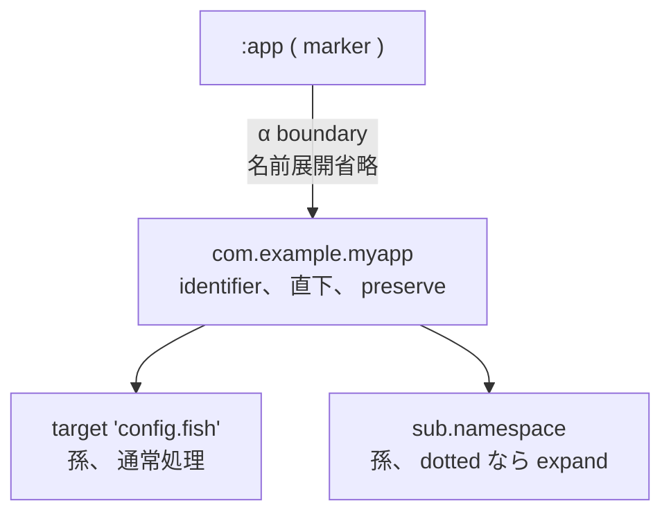

# neco-kdl-ast 構文リファレンス

[English](syntax-en.md)

KDL を構造化 IR の入れ物として使う際の表記規律と、各規律の具体例を示す。

## 用語

| 用語 | 定義 |
|---|---|
| segment | NsidPath を構成する単位、1 つの非空文字列 |
| NsidPath | 0 個以上の segment の有限列、string 表現は segment を `.` で連結 |
| fragment | CrossRef 内で `#` の右に置かれる単一の識別子 |
| form X | KDL ノード 表現で `<kind keyword> "<identifier>"` 形 ( `item "i64.add"` 等 ) |
| form Y | ノード名自体に NsidPath を埋め込む KDL 表現 |
| layout mode | FS パス との対応の厳密さ ( strict・bundle・cratis dir の 3 種 ) |

## NsidPath

NsidPath は 0 個以上の segment の有限列。各 segment は **空でない**文字列、`.` と `#` を含まない。

### 表記

```
"a"           ← 1 segment OK
"a.b.c"       ← 3 segment OK
""            ← 0 segment OK ( local-only CrossRef で使用 )
"a..b"        ← NG: 連続 . で空 segment
"a.#x.b"      ← NG: segment "#x" が # を含む
".a.b"        ← NG: leading . で空 segment ( ただし node 名 leading dot は手続き入れ子表記で別解釈、 後述 )
```

検査は `NsidPath::is_well_formed()` で行う。

### parse / display の 往復

```rust
NsidPath::parse("")          // → 空 NsidPath ( segments == [] )
NsidPath::parse("a.b.c")     // → segments == ["a", "b", "c"]
NsidPath::parse("a.b.c").display()  // → "a.b.c" ( 往復 )
```

任意の well-formed `s` で `NsidPath::parse(s).display() == s`。

### FS パス との対応

n segment NsidPath は FS パス へ変換すると、同じ n の深さを持つ:

```
NsidPath::parse("app.bsky.actor.getProfile").to_fs_path("json")
// → PathBuf "app/bsky/actor/getProfile.json"   ( 3 dir + 1 leaf = 4 path component )

NsidPath::from_fs_path(
    Path::new("axiom/encoding/base64.kdl"),
    Path::new("axiom/")
)
// → Some(NsidPath ["encoding", "base64"])      ( ext "kdl" を strip、 dir + file stem を join )
```

base の外に出る パス、またはドット・ハッシュを含む segment は `None` を返す。

## CrossRef

別の対象 への参照を表す。`#` を高々 1 個含み、fragment は flat な 識別子 である。

### 3 形式

```
"a.b.c"        ← path 部のみ                     → CrossRef { path: [a,b,c], fragment: None }
"a.b.c#frag"   ← path + fragment                 → CrossRef { path: [a,b,c], fragment: Some("frag") }
"#frag"        ← local-only ( current document ) → CrossRef { path: [], fragment: Some("frag") }
```

### parse error 4 種

| error | 例 |
|---|---|
| `MultipleHashes` | `"a#b#c"` ( # が 2 つ以上 ) |
| `EmptyFragment` | `"a.b.c#"` ( # の右が空 ) |
| `DotInFragment` | `"a.b.c#x.y"` ( fragment に . が混入 ) |
| `EmptySegment` | `"a..b"` ( 連続 . で空 segment 発生 ) |

### 具体例

```
path のみの参照
  ref "pkg.module.func"
  → CrossRef::parse("pkg.module.func") = path:[pkg,module,func], fragment:None

atproto Lexicon の output ref
  output "app.bsky.actor.defs#profileViewDetailed" encoding="application/json"
  → CrossRef::parse("app.bsky.actor.defs#profileViewDetailed")
    = path:[app,bsky,actor,defs], fragment:Some("profileViewDetailed")

atproto union 内の local ref
  refs ["#main" "#profileView"]
  → CrossRef::parse("#main") = path:[], fragment:Some("main"), is_local=true
```

## NsidPath を表現する 4 form

n segment NsidPath は KDL / FS で 4 通りの表現を持つ。各 form の階層深度は同 n。

### 例: `app.bsky.actor.getProfile` ( 4 segment )

#### 平坦 KDL form X ( kind keyword ＋ 引用符付き識別子 )

```kdl
item "app.bsky.actor.getProfile" {
    procedure { ... }
}
```

#### 平坦 KDL form Y ( ノード名に NsidPath を埋め込む )

```kdl
app.bsky.actor.getProfile {
    procedure { ... }
}
```

#### nested KDL ( 4 nesting level )

```kdl
app {
    bsky {
        actor {
            getProfile {
                procedure { ... }
            }
        }
    }
}
```

#### FS materialization ( strict 1:1 mode、3 dir + 1 leaf file )

```
<base>/app/bsky/actor/getProfile.<ext>
```

### 例: `encoding.base64` ( 2 segment ) を bundle で

`axiom/encoding/base64.kdl` は、`encoding.base64` を表す 2 dir + 1 file の パス である。
この file には複数の対象がある。
各対象の 識別子は、この パス を prefix として持つ。

```kdl
// file: axiom/encoding/base64.kdl
item encoding.base64.encode {
    procedure { ... }
}
item encoding.base64.decode {
    procedure { ... }
}
```

各対象の 識別子の prefix は、この パス から導出される。

## FS パス との対応 ( layout mode 3 種 )

### universal mapping

base 配下 FS パス `<base>/s₁/s₂/.../sₙ.<ext>` から導出される NsidPath:

```
NsidPath::from_fs_path("axiom/encoding/base64.kdl", base="axiom/")
  → Some(["encoding", "base64"])    // ext .kdl を strip、 dir + file stem を join
```

### strict 1:1 mode ( atproto 流 )

file の最上位 対象 は、識別子 が特定の NsidPath と等しい。
この NsidPath は FS パス から導出される:

```
file: app/bsky/actor/getProfile.json    ( base = "app/" )
FS-derived NsidPath: [bsky, actor, getProfile]
top entity must have identifier == [bsky, actor, getProfile]

→ verify_layout(Strict1To1, ...) pass
```

違反例:

```
file: app/bsky/actor/getProfile.json
top entity identifier == "different.path"
→ LayoutViolation { kind: StrictMismatch, ... }
```

### bundle mode

file 内 **複数の対象** の 識別子 が FS パス から導出される NsidPath を **strict prefix** に持つ:

```
file: axiom/encoding/base64.kdl    ( base = "axiom/" )
FS-derived NsidPath: [encoding, base64]
file 内 entity:
  item "encoding.base64.encode"     identifier=[encoding,base64,encode]    starts_with [encoding,base64] OK
  item "encoding.base64.decode"     identifier=[encoding,base64,decode]    starts_with [encoding,base64] OK
  item "encoding.base64.decode_url" identifier=[encoding,base64,decode_url] starts_with [encoding,base64] OK

→ verify_layout(Bundle, ...) pass
```

違反例:

```
file: axiom/encoding/base64.kdl
file 内 entity:
  item "i32.add"    ← identifier が prefix を持たない
→ LayoutViolation { kind: BundlePrefixMismatch, ... }
```

### cratis dir mode

FS パス との対応検査を適用しない。
対象の 識別子は first arg のみで決まる。
dir tree は categorization に閉じる:

```
file: items/group/widget/config.kdl
file 内 entity:
  item "widget" { ... }    ← identifier = [widget]、 dir tree から独立

→ verify_layout(CratisDir, ...) は常に 0 violation
```

### LayoutViolation の kind

| kind | 意味 |
|---|---|
| `StrictMismatch` | strict mode の不一致、下記参照 |
| `BundlePrefixMismatch` | bundle mode の prefix 欠落、下記参照 |
| `IllegalSegment` | segment がドットまたはハッシュを含む |
| `PathOutsideBase` | file_path が base 配下にない |
| `StrictMultipleEntities` | strict mode の 対象 複数、下記参照 |

`StrictMismatch` は strict mode で発生する。
対象の 識別子 が、FS パス 由来の NsidPath と等しくない場合である。

`BundlePrefixMismatch` は bundle mode で発生する。
対象の識別子が、FS パス由来の識別子で始まり、かつそれより長いという strict prefix の条件を満たさない場合である。

`StrictMultipleEntities` は strict mode で発生する。
file 内の top-level 対象が 2 つ以上ある場合である。

## 解決経路

`Document::resolve` は CrossRef の 3 形式を、呼び出し先の document 内部で解決する:

```
match (cross_ref.is_local(), cross_ref.fragment()) {
    (true,  Some(frag)) => 現在の document 内で、 最上位の identifier から frag を引く ( local-only )
    (false, None)       => 現在の document 内で、 最上位の identifier から path を引く
    (false, Some(frag)) => path で対象を引いた後、 その対象の内部で fragment を引く
}
```

### 例

```rust
// (1) path のみ
let cr = CrossRef::parse("str.find").unwrap();
doc.resolve(&cr)
// → str.find entity を返す ( kind は呼び出し側の定義による )

// (2) local-only fragment
let cr = CrossRef::parse("#profileView").unwrap();
doc.resolve(&cr)
// → current document 内で identifier="profileView" な entity を返す
//   ( 入れ子の定義には path#fragment の qualified 形が必要 )

// (3) path + fragment
let cr = CrossRef::parse("app.bsky.actor.defs#profileViewDetailed").unwrap();
doc.resolve(&cr)
// → app.bsky.actor.defs entity を引いた後、 その内部で profileViewDetailed を引く
```

## 包みの観点による 5 軸の同型表記

KDL の論理構造は、対象が別の対象 を包むという単一の関係に還元できる。
property・type annotation・kind keyword 等の様々な syntax は、この入れ子関係を読みやすさのために圧縮した表記である。

5 軸の同型表記が独立に成立し、AST layer は 利用者が宣言する **Convention** に応じて それぞれを 往復変換 として扱う。

### 5 軸 一覧

- 1. namespace
  - 圧縮形: `parent.child { body }`
  - nested 形: `parent { child { body } }`
  - 条件: 中間ノード に args・properties・siblings がない
- 2. procedure
  - 圧縮形: `chain { call "a"; .call "b" }`
  - nested 形: `chain { call "a" { call "b" } }`
  - 条件: dot prefix を解釈する kind を利用者が指定する
- 3. property-child
  - 圧縮形: `node key=v`
  - nested 形: `node { key v }`
  - 条件: 子ノードは arg 1 つのみ、properties・子ノード がない
- 4. type annotation
  - 圧縮形: `node (T)val`
  - nested 形: `node { <marker> T { val } }`
  - 条件: 利用者が type marker を宣言する
- 5. kind keyword
  - 圧縮形: `item "foo" { body }`
  - nested 形: `item { <marker>foo { body } }`
  - 条件: 利用者が 識別子 marker を宣言する

5 軸すべて、parent が 子ノードを含む同じ root principle の圧縮である。
同一の対象 で複数軸が同時に effective でもよい ( 軸は独立 )。

### Convention と Marker

AST layer の 変換群は 利用者が宣言する **Convention** を取る。Convention は 利用者 領域の予約識別子 ( **Marker** ) のリストを保持する。

```rust
pub struct Convention {
    pub markers: Vec<Marker>,
    pub namespace_form: AxisForm,
    pub procedure_form: AxisForm,
    pub property_child_form: PropertyChildForm,
    pub type_annotation_form: AxisForm,
    pub kind_keyword_form: AxisForm,
}

pub enum Marker {
    /// 予約 kind 名 ( 例 "_type" )
    Kind(String),
    /// 予約 prefix 文字 ( 例 ':' )
    Prefix(char),
}
```

軸 ごとの正規形宣言は § Convention の正規形宣言 を参照。

Marker は **modifier** ( 1 階下の 子ノードを 単一の意味単位として包むラッパー ) を表す。例:

- 型注釈 marker: prefix で型名を示す ( 例: `:type` )
- 識別子 marker ( 例: `@id` ): 識別子を示す
- 利用者定義の wrapper ( 例: `:app` ): 対象の body を包む

modifier は一般化した form であり、`expr.chain` や `expr.call` と同型の構造を持つ ( 1 階下を意味単位として包む )。
AST layer は marker を、直下の 1 階が単一の意味単位であると示す境界として扱う。

### α semantics: marker は modifier として 1 階の境界を作る

Convention に登録された marker 配下では、**直下 子ノードの名前展開を省略**する ( 孫以降は 通常処理 )。



```kdl
:app {
    com.example.myapp {     ← :app 直下、 nest で展開しない ( 単一 entity identifier )
        target "config.fish" { ... }   ← 孫、 通常処理 ( target は dotted ではないので影響なし )
        sub.namespace { body }         ← 孫、 dotted 単一子 chain なら nest で展開される
    }
}
```

α を採用する理由:
- marker form は内部表現 ( 出力 form として通常使わない )
- modifier の内側は 通常の構造として扱う設計が自然
- subtree ( 部分木 ) 全体を保持したい場合は、利用者が深層に marker を入れ子状に置けば対応できる

### 軸 1: namespace ( dot collapse )

連続する単一子の namespace block は collapse が可能である。
1 つの dotted ノード名へまとめられる。
nested form と flat-dot form は意味論的同型である。

#### 適用可能な例 ( pure namespace chain )

```kdl
// nested form
encoding {
    base64 {
        encode {
            procedure { ... }
        }
    }
}
```

意味論的同型:

```kdl
// flat dot-collapse form
encoding.base64.encode {
    procedure { ... }
}
```

両 form は同一 NsidPath を表す ( 例: `[encoding, base64, encode]` )。
`Document::flatten` と `Document::nest` で往復可能。

#### 部分的に畳み込めない例

中間ノード に **args / properties / siblings** のいずれかがあると、その箇所の collapse だけが妨げられる ( 情報損失を避けるため )。対象となる他の箇所は変換されうる。

```kdl
// The parent has an argument and stays uncollapsed.
a "intermediate-arg" {
    b {
        c { ... }
    }
}

// The parent has multiple children and stays uncollapsed.
a {
    b { ... }
    other { ... }    ← b と並ぶ sibling のため flatten 不可
}

// The parent has a property and stays uncollapsed.
a key="value" {
    b { ... }
}
```

`flatten()` は、一部でも畳み込みができた場合、適用後の Document と `Applied` を返す。
どの部分も畳み込めなかった場合に限り、reason 付きの `NoOp` を返し、Document は変更せずそのまま返す。

#### marker boundary

`nest` は marker 配下の 直下の子ノード で名前展開を省略する。
この挙動を α semantics と呼ぶ ( 直前 § 参照 )。

### 軸 2: procedure ( dot prefix )

連続した手続きを表す chain・step・pipeline 配下では、ノード名の leading dot 個数が、chain 内の深さを表す。
dot のない sibling は、同じ深さの要素としてそのまま解釈する ( pipeline としては扱わない )。

#### depth 規律

```kdl
chain {
    call "a"      ← dot 0 個 = chain 直下 ( depth 0 )
    .call "b"     ← dot 1 個 = depth 1、 直前の depth 0 ( = "a" ) の child
    .call "c"     ← dot 1 個、 直前の depth 0 ( = "a" ) の child、 b と sibling
    ..call "d"    ← dot 2 個 = depth 2、 直前の depth 1 ( = "c" ) の child
}
```

#### 入れ子 form と双方向同型

上記 dot-prefix form は次の deep-nested form と意味論的同型:

```kdl
chain {
    call "a" {
        call "b" {}
        call "c" {
            call "d" {}
        }
    }
}
```

`expand_dot_chain` で dot-prefix から deep-nested へ変換する。
`collapse_dot_chain` で逆変換し、往復可能。

#### kind 単位の指定

`expand_dot_chain` と `collapse_dot_chain` は、kind 引数で対象を指定する。
AST layer は構文解釈の基本機能のみ提供し、どの kind で解釈するかは利用者が宣言する。

```rust
doc.expand_dot_chain("call", &conv);   // call を入れ子 chain として解釈
doc.expand_dot_chain("step", &conv);   // step を入れ子 chain として解釈
// 他 kind は touch されない
```

#### 視覚的可読性 ( 比較 )

3 step linear pipeline `a → b → c`:

```kdl
// dot-prefix form ( 視覚的に深さが見える、 brace 入れ子なしで簡潔 )
chain {
    call "a"
    .call "b"
    ..call "c"
}

// deep-nested form ( 同型 alternative、 brace 入れ子で深さが見える )
chain {
    call "a" {
        call "b" {
            call "c" {}
        }
    }
}

// flat siblings ( pipeline ではなく独立 sibling 解釈、 別 semantics )
chain {
    call "a"
    call "b"
    call "c"
}
```

dot の有無で、入れ子か同じ深さの sibling かが syntactic に決まる ( convention 非依存 )。

#### branching の表現

```kdl
chain {
    call "a"
    .call "b1"     ← a の child
    .call "b2"     ← a の child、 b1 と sibling ( branching )
    ..call "c"     ← b2 の child ( 直前の depth 1 entry が b2 )
}
```

同型 deep-nested form:

```kdl
chain {
    call "a" {
        call "b1" {}
        call "b2" {
            call "c" {}
        }
    }
}
```

#### depth jump の不正

dot 個数が「直前 entry の depth + 1」 を超える jump は不正:

```kdl
chain {
    call "a"      ← depth 0
    ..call "b"    ← NG: dot 0 から dot 2 への jump、 中間 depth 1 が無い
}
```

`expand_dot_chain` は深さの jump を reason として記録した `NoOp` を返す。

### 軸 3: property-child

property `key=value` は、同名の 子ノード `key value` と意味論的同型である。
ただし 子ノードは arg を 1 つだけ持ち、properties と 子ノードを持たない。

```kdl
some.node "name" value="something" is=#false count=3 { body }
```

nested 展開:

```kdl
some.node "name" {
    value "something"
    is #false
    count 3
    body
}
```

両 form で、各 accessor は同じ値を返す。
`attribute_str` は `Some("something")` を返す。
`attribute_bool` は `Some(false)` を返す。
`attribute_int` は `Some(3)` を返す。

property の値に type annotation がある場合も、同じ位置に保たれる。
子ノード形でも位置は変わらない。

```kdl
some.node value=(i32)42       ← property、 値の型 i32
```

≡

```kdl
some.node { value (i32)42 }   ← child、 first arg の型 i32
```

`Document::expand_properties` と `Document::collapse_properties` で往復可能。
子ノード から property への collapse は、次の条件を満たす 子ノード だけに可能:
- positional arg を ちょうど 1 つ持つ
- properties を持たない
- 子ノードを持たない

複数の arg を持つ 子ノードは、単独 property への collapse が不可能である。

### 軸 4: type annotation

type annotation `(T)V` は、利用者が宣言する marker に応じて往復する。
marker が type 名を wrap した form との間で変換される。

利用者が type marker を `Marker::Kind("_type")` で宣言した場合:

```kdl
input { (integer)value required=#true }
```

`expand_type_annotations(&Marker::Kind("_type".into()), &conv)`:

```kdl
input {
    _type integer {
        value required=#true
    }
}
```

`collapse_type_annotations(&Marker::Kind("_type".into()), &conv)` で逆変換、元に戻る ( 往復 lossless )。

prefix 形 ( `Marker::Prefix(':')` ) でも同様:

```kdl
input { (integer)value required=#true }
```

`expand_type_annotations(&Marker::Prefix(':'), &conv)`:

```kdl
input {
    :integer {
        value required=#true
    }
}
```

### 軸 5: kind keyword ( form X・form Y・nested form の統合 )

kind keyword は 子ノードを包む形である。
これは 識別子 marker 経由の表現と等価である。

利用者が 識別子 marker を `Marker::Prefix('@')` で宣言した場合:

```kdl
item "foo" { procedure { ... } }
```

`expand_kind_keyword(&Marker::Prefix('@'), &conv)`:

```kdl
item {
    @foo {
        procedure { ... }
    }
}
```

`collapse_kind_keyword(&Marker::Prefix('@'), &conv)` で逆変換。

3 form の関係:
- form X ( `<kind> "<id>" <body>` ): 最初の string 引数に 識別子
- form Y ( `<id> <body>`、kind 暗黙 ) : ノード名に 識別子
- marker 付き nested form ( `<kind> { <marker><id> <body> }` )
  marker が 識別子 位置を明示する完全な形である。

3 form は、利用者 convention を介して相互変換可能である。
read-side accessor は form X と form Y を直接区別する:

- `structured_name`
- `structured_name_form_x`
- `structured_name_form_y`

### dot 区切りの 2 軸 ( syntactic position の区別 )

軸 1 ( namespace ) と 軸 2 ( procedure ) はいずれも `.` を使うが、**位置で区別** される:

| 軸 | dot の位置 | 意味 |
|---|---|---|
| 軸 1 ( namespace ) | ノード名の途中 ( 例: `a.b.c` ) | 名前空間の区切り |
| 軸 2 ( procedure ) | ノード名の先頭 ( 例: `.call` ) | 入れ子の深さ表記 |

混在例:

```kdl
chain {
    morph.derives "str.contains"     ← internal dot ( namespace 区切り、 kind = morph.derives )
    .morph.derives "str.starts_with" ← leading dot ( depth 1 ) + internal dot ( namespace 区切り )
}
```

AST layer は 2 軸を独立に解釈する。

### 値層での展開停止

軸 4・軸 5 の nested 展開は、葉の値が KDL の bare 識別子 として有効な場合のみ成立する:
- `(i32)val` ↔ `<marker> i32 { val }`
  両方とも bare な 識別子のため valid である。
- `(i32)42` ↔ `<marker> i32 { 42 }`
  42 は bare 識別子 ではなく、KDL 仕様で数値リテラルは識別子として使えないため invalid である。

実用上の代替: `(i32)42` の完全展開は `<marker> i32 42` で止まる。
42 は marker 付き i32 ノード の first-arg として留まり、値はこれ以上入れ子にならない。

### 具体例: reverse-domain 識別子の保持

reverse-domain 識別子を含む app 宣言を往復する例を示す ( 例: `com.example.myapp` )。
識別子 に dot を含むため、軸 1 の namespace 展開を marker で保護する必要がある。

original ( type annotation 形 `(app)<id>` ):

```kdl
(app)com.example.myapp {
    bindings { self flatpak="com.example.myapp" }
    target "config.fish" {
        writer "verbatim"
        path "/home/user/.config/myapp/config.toml"
    }
}
```

手順 1. 利用者 convention 設定:

```rust
let app_marker = Marker::Prefix(':');
let conv = Convention::new().with_marker(app_marker.clone());
```

手順 2. 軸 4 expand: 型注釈を marker form へ変換する。
`(app)` が `:app` になる

```rust
let (doc, _) = doc.expand_type_annotations(&app_marker, &conv);
```

結果:

```kdl
:app {
    com.example.myapp {
        bindings { self flatpak="com.example.myapp" }
        target "config.fish" {
            writer "verbatim"
            path "/home/user/.config/myapp/config.toml"
        }
    }
}
```

手順 3. 軸 1 nest ( namespace 展開 ):
`:app` は conv の marker である。
直下の `com.example.myapp` は α semantics により保持される。
孫以下は通常処理するが、dotted ノード名がないため変化しない。

```rust
let (doc, _) = doc.nest(&conv);
```

結果は不変 ( marker boundary が機能 )。

手順 4. 逆変換 ( marker form から元の type annotation 形へ ):

```rust
let (doc, _) = doc.collapse_type_annotations(&app_marker, &conv);
```

結果は元の入力と一致 ( 往復 lossless )。

### 軸 1・3・4・5 を適用した具体例 ( item )

original ( 圧縮 form 、軸 1 / 3 / 4 / 5 が同時に圧縮されている ):

```kdl
item text.string.from_int version=1 {
    procedure {
        input {
            (integer)value required=#true
        }
        output {
            (string)result required=#true
        }
    }
}
```

手順 1. 軸 3 expand ( `version=1` 等の property を子ノードへ変換 ):

```kdl
item "text.string.from_int" {
    procedure {
        input {
            (integer)value {
                required #true
            }
        }
        output {
            (string)result {
                required #true
            }
        }
    }
    version 1
}
```

手順 2. 軸 5 expand: `item` を 識別子 marker `@` で包む。
利用者 convention に `Marker::Prefix('@')` を使用:

```kdl
item {
    @text.string.from_int {
        procedure {
            input {
                (integer)value {
                    required #true
                }
            }
            output {
                (string)result {
                    required #true
                }
            }
        }
        version 1
    }
}
```

手順 3. 軸 1 nest:
`@text.string.from_int` 自体が marker 付き ノード であるため、α semantics により直下の子ノードは preserve の対象になる。
登録された @ marker 自体と、その直下の名前が保護されるため、識別子は平坦なまま残り、この例の nest は NoOp になる。

```kdl
item {
    @text.string.from_int {
        procedure {
            input {
                (integer)value {
                    required #true
                }
            }
            output {
                (string)result {
                    required #true
                }
            }
        }
        version 1
    }
}
```

手順 4. 軸 4 expand: integer と string の型注釈を `:` marker で包む。
手順 1 で展開済みの `required #true` 子ノードはそのまま保たれる:

```kdl
item {
    @text.string.from_int {
        procedure {
            input {
                :integer {
                    value {
                        required #true
                    }
                }
            }
            output {
                :string {
                    result {
                        required #true
                    }
                }
            }
        }
        version 1
    }
}
```

この例では、軸 1 の nest が NoOp のため `@text.string.from_int` は平坦なまま残り、型注釈は marker 付きの入れ子として表現される。
ergonomic ではないが、複数の軸が独立に働く様子と、値層の扱いを同時に確認できる点で明確である。
値層 ( 数値・bool・null ) は arg 位置に留まり、これ以上展開しない ( 例: `version 1` の `1` )。

### AST layer の対応 ( 5 軸 × expand/collapse、Convention threading )

| 軸 | expand | collapse |
|---|---|---|
| 1. namespace | `Document::nest(&conv)` | `Document::flatten(&conv)` |
| 2. procedure | `Document::expand_dot_chain(kind, &conv)` | `Document::collapse_dot_chain(kind, &conv)` |
| 3. property-child | `Document::expand_properties(&conv)` | `Document::collapse_properties(&conv)` |
| 4. type annotation | `Document::expand_type_annotations(&target, &conv)` | `Document::collapse_type_annotations(&source, &conv)` |
| 5. kind keyword | `Document::expand_kind_keyword(&target, &conv)` | `Document::collapse_kind_keyword(&source, &conv)` |

各変換は `&Convention` を取る。
conv の marker 配下の 直下の子ノードは、α semantics により保持される。
軸 4・5 は target/source marker を per-call で指定し、利用者は同じ Marker を conv にも含める。

### read-side accessor ( 変換経由しない直接参照 )

変換を実行せずに 利用者が値を引きたい場合の accessor:

| 軸 | accessor |
|---|---|
| 1. namespace | `node_name_as_nsid()` ( `.` split ) |
| 2. procedure | `dot_chain_depth()` / `dot_chain_kind()` |
| 3. property-child | 下記の accessor ( 同値を返す ) |
| 4. type annotation | `type_annotation()` ( ノード/entry の型取得 ) |
| 5. kind keyword | 下記の accessor |

property-child の accessor:

- `attribute_str`
- `attribute_bool`
- `attribute_int`

kind keyword の accessor:

- `structured_name()`
- `structured_name_form_x()`
- `structured_name_form_y()`

read-side accessor は、property か 子ノード か、X か Y かを利用者が選んでも一定値を返す。
同型の lookup 経路である。

### AST layer の position

AST layer は **「構文解析器 + パラメータ化可能な normalizer」** の 2 層構造:

- 構文解析器 ( neco-kdl ): KDL 構文を論理構造へ変換し、全要素を保持する
- **AST layer ( neco-kdl-ast )**: 論理構造 + 利用者が宣言する Convention で、5 軸の同型変換 を提供

kind 名や型名等の semantic keyword 自体は利用者の領域である。
利用者が prefix や kind 名を marker と宣言すれば、その等価性を構造的往復変換として吸収する。

## Convention の正規形宣言

`Convention` は marker の list に加え、軸 1-5 ごとの正規形宣言を保持する。
`render_as` はこの宣言に従い、軸 1-5 の expand / collapse を crate 規定の順序で適用する。

### per-axis 正規形宣言の型

```rust
pub enum AxisForm {
    Off,                         // 軸 OFF
    Expand,                      // 展開形を正規形 ( 軸 1 / 2 用 )
    Collapse,                    // 圧縮形を正規形 ( 軸 1 / 2 用 )
    ExpandWithMarker(Marker),    // 軸 4 / 5 用 expand
    CollapseWithMarker(Marker),  // 軸 4 / 5 用 collapse
}

pub enum PropertyChildForm {
    Off,
    Expand,    // fused-form expand: properties → flat `key v` child nodes
    Collapse,  // fused-form collapse: flat `key v` child nodes → properties
}

pub struct Convention {
    pub markers: Vec<Marker>,
    pub namespace_form: AxisForm,        // 軸 1
    pub procedure_form: AxisForm,        // 軸 2
    pub property_child_form: PropertyChildForm,  // 軸 3 ( 融合形のみ、 nested form variant なし )
    pub type_annotation_form: AxisForm,  // 軸 4
    pub kind_keyword_form: AxisForm,     // 軸 5
}
```

### 軸 OFF

`AxisForm::Off` と `PropertyChildForm::Off` は、表記差を解釈せず入力のまま保持する宣言である。
既定の `Convention` は全軸 off で、既存の 読み取りアクセサ の振る舞いを完全互換に保つ。

### 融合形 ( fused form )

軸 3 ( property-child ) は、KDL property 構文の制約により expand 結果が融合形のみとなる。
融合形は、`key=v` と `mod_key v` の flat 子ノード との対応である。
`mod_key` は abstract 表記であり、そのままの prefix 文字列ではない。
構造制約の axiom として、nested 形は `PropertyChildForm` enum に存在せず、構築できない。

他 4 軸 ( namespace・procedure・type annotation・kind keyword ) は同じ `AxisForm` 型を共有し対称である。
軸 3 のみ別 enum で、この非対称性をそのまま表現する。

### `render_as` の軸間順序

`render_as(&Convention)` は軸 5 → 軸 4 → 軸 1 → 軸 2 → 軸 3 の順で per-axis transform を適用する。順序根拠は **marker 境界保護**:

1. 軸 5 ( kind keyword ) で marker prefix を立て
2. 軸 4 ( type annotation ) で type marker を立て
3. 軸 1 ( namespace ) の nest を適用する ( marker 配下は α semantics により保持 )
4. 軸 2 ( procedure ) で procedure 構造を展開
5. 軸 3 ( property-child ) で entry 位置を整える

上記の具体例は、各軸の変換を個別の手順として順に適用したものであり、`render_as` が内部で用いる軸 5・4・1・2・3 の固定順序とは異なる ( § 軸 1・3・4・5 を適用した具体例 を参照 )。
軸 2 ( procedure ) は `Marker::Kind` を dot-chain 対象として再利用する。
利用者が `with_marker(Marker::Kind("call".to_owned()))` で対象を宣言する。

### 具体例

```rust
use neco_kdl_ast::{AxisForm, Convention, Document, Marker, PropertyChildForm};

// (1) 既定 Convention で render_as は identity ( 全軸 OFF )
let doc = Document::parse(r#"node "name" value="x""#).unwrap();
let rendered = doc.render_as(&Convention::default());
// → rendered は doc と同等

// (2) 軸 1 namespace expand のみ宣言
let conv = Convention::new().with_namespace_form(AxisForm::Expand);
let nested = doc.render_as(&conv);

// (3) 全軸 expand の Convention ( 5 軸同時 normalize )
let app_marker = Marker::Prefix(':');
let id_marker = Marker::Prefix('@');
let conv = Convention::new()
    .with_marker(app_marker.clone())
    .with_marker(id_marker.clone())
    .with_marker(Marker::Kind("call".to_owned()))
    .with_kind_keyword_form(AxisForm::ExpandWithMarker(id_marker))
    .with_type_annotation_form(AxisForm::ExpandWithMarker(app_marker))
    .with_namespace_form(AxisForm::Expand)
    .with_procedure_form(AxisForm::Expand)
    .with_property_child_form(PropertyChildForm::Expand);
let fully_expanded = doc.render_as(&conv);
```

`Convention` は呼び出しごとに指定するため、同一 `Document` を異なる正規形で render 可能である。
利用者ごとに読みやすい構造を場面で使い分けられる。

## 利用例

### atproto Lexicon の KDL 表現 ( form Y・型注釈 頻発 )

```kdl
lexicon app.bsky.actor.getProfile version=1 xrpc=query {
    description "Get detailed profile view of an actor"
    params {
        (string)actor required=#true format=at-identifier
    }
    output "app.bsky.actor.defs#profileViewDetailed" encoding="application/json"
}

lexicon app.bsky.actor.defs version=1 {
    defs {
        (object)profileViewDetailed {
            (string)did format=did required=#true
            (string)handle format=handle required=#true
            (string)displayName? max-length=640
            (object)viewer? type="app.bsky.actor.defs#viewerState"
        }

        (object)viewerState {
            (boolean)muted?
            (string)blockedBy? type="app.bsky.graph.defs#blockView"
        }
    }
}
```
